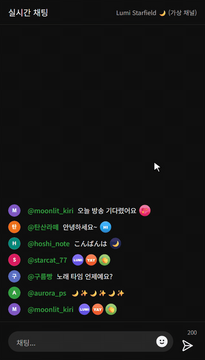

# yt-subs-ux

[](README.md)
[](README.ja.md)
[](README.en.md)

A Chrome extension that improves the YouTube emoji picker for channel subscribers and members. Reorder emojis the way you like, and save the emoji combos and chat "danmaku" you use often so you can enter them with one click.

This is an unofficial project and is not affiliated with or endorsed by Google LLC. "YouTube" is a trademark of Google LLC.

<p align="center">
  
  
  
</p>
<p align="center"><sub>Reorder channel emojis · Save a danmaku from chat and send it · Make a phrase with the emoji palette<br>Demos use a fictional channel, viewers and emojis.</sub></p>

> The extension's UI follows YouTube's display language: Korean, Japanese, or English (English for any other language).

## Features

### Emoji order

Use the **`⇅ Order`** button next to each category title in the emoji picker.

- Drag to reorder. Double-click moves an emoji to the front, Alt+click to the end.
- Channel member emojis are saved **per channel**.
- Standard Unicode categories (People, Nature, …) can be reordered too.
- Emojis the channel adds later go to the end, in their default order.

### Emoji phrases (danmaku) — live chat

Save emoji combos or the danmaku a channel's viewers share (for example `🥀🎶🥀🎶🥀🎶`), and enter them with one click.

- A **Phrases** category (speech-bubble tab) is added as the second category of the emoji picker.
  - Click: enter the phrase in the chat input
  - Right-click: edit / copy as text / delete
  - Drag: reorder
- **Adding phrases**
  - Hover over a chat message and click **☆** to save that message as a phrase.
  - Click **`+ Add`** in the phrases category to write one in a popup, with an emoji palette (category tabs and search) and text input. You can also append existing phrases from the palette.
- **Scope**: `This channel only` (default) or `All channels`. Phrases that contain channel member emojis can only be saved for that channel.
- Emojis are entered through YouTube's own emoji picker, so they are sent the same way as emojis you pick yourself.

## Install

1. Download the zip from [Releases](https://github.com/crazylulu9999/yt-subs-ux/releases), or clone this repository.
2. Open `chrome://extensions` and turn on **Developer mode**.
3. Click **Load unpacked** and select the folder that contains `manifest.json`.
4. Reload any YouTube tabs that are already open.

To update, replace the files, click the reload (↻) button for this extension in `chrome://extensions`, then reload YouTube.

## Data and privacy

- Emoji orders and phrases are stored **only in this browser** (`chrome.storage.local`). They are not synced to other PCs or browsers, and they are removed when you uninstall the extension.
- The extension sends no data to any server. The only permission it requests is `storage`.
- It runs only on `https://www.youtube.com/*`.

## Limits

- Phrases work in **live chat** only, not in chat replays or comments.
- For chat on a video page, the channel is identified from the video's channel link (`@handle`), so you can make `This channel only` phrases **even if you aren't a member**. To get the channel ID, the extension loads that channel's page (youtube.com/@handle) the first time (retrying a little later if that fails) and keeps the result in this browser. It also uses channel member emojis in the emoji picker or in chat. If the channel can't be identified (for example, in pop-out chat with no channel emojis), phrases can only be saved for all channels.
- If YouTube changes its page structure, buttons or emoji input may stop working.

## Project structure

```
manifest.json            Extension settings (Manifest V3)
_locales/                Extension name and description (ko/ja/en)
content/
  i18n.js                UI strings (Korean, Japanese, English)
  theme.js               Dark mode detection (<html class="ytx-dark">)
  emoji-order.js / .css  Emoji order
  phrases.js / .css      Emoji phrases (danmaku)
```

Plain JavaScript and CSS with no build step. Edit a file, then reload the extension.

## If something stops working

YouTube may have changed its page. Please open an [issue](https://github.com/crazylulu9999/yt-subs-ux/issues) with a screenshot and, if you can, the HTML of the emoji picker or chat input (DevTools → right-click the element → Copy → Copy outerHTML). Remove other viewers' names and messages before posting.

## License

[MIT License](LICENSE)
