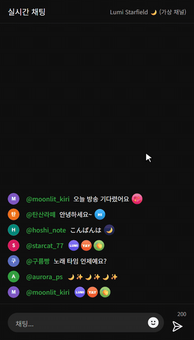

# yt-subs-ux

[](README.md)
[](README.ja.md)
[](README.en.md)

YouTube チャンネルの登録者・メンバー向けに、絵文字ピッカーを使いやすくする Chrome 拡張機能です。絵文字の並び順を自由に変えたり、よく使う絵文字の組み合わせやチャットの**弾幕**を保存して、ワンクリックで入力したりできます。

非公式のプロジェクトであり、Google LLC とは関係がなく、Google LLC の承認も受けていません。「YouTube」は Google LLC の商標です。

<p align="center">
  
  
  
</p>
<p align="center"><sub>チャンネル絵文字の並べ替え · チャットの弾幕を保存して送信 · 絵文字パレットで定型文を作成<br>デモのチャンネル・視聴者・絵文字はすべて架空のものです。</sub></p>

> 拡張機能の UI は YouTube の表示言語に合わせて、韓国語・日本語・英語で表示されます(それ以外の言語では英語)。

## 機能

### 絵文字の並び順

絵文字ピッカーの各カテゴリ名の右にある **`⇅ 並び順`** ボタンを使います。

- ドラッグで並べ替え。ダブルクリックで先頭へ、Alt+クリックで末尾へ移動します。
- チャンネルのメンバー絵文字は**チャンネルごと**に保存されます。
- 通常の Unicode カテゴリ(人物、自然 …)も並べ替えられます。
- 後からチャンネルに追加された絵文字は、既定の順序で末尾に付きます。

### 絵文字の定型文(弾幕) — ライブチャット

よく一緒に使う絵文字の組み合わせや、チャンネルの視聴者で共有している弾幕(例: `🥀🎶🥀🎶🥀🎶`)を保存して、ワンクリックで入力します。

- 絵文字ピッカーの 2 番目のカテゴリとして**定型文**(吹き出しのタブ)が追加されます。
  - クリック: チャット入力欄に入力
  - 右クリック: 編集 / テキストとしてコピー / 削除
  - ドラッグ: 並べ替え
- **登録方法**
  - チャットメッセージにマウスを乗せると表示される **☆** ボタンで、そのメッセージを定型文として保存します。
  - 定型文カテゴリの **`+ 追加`** を押すと、ポップアップで絵文字パレット(カテゴリタブ・検索)とテキスト入力を使って作成できます。パレットから既存の定型文を続けて追加することもできます。
- **範囲**: `このチャンネルのみ`(既定)または `すべてのチャンネル`。チャンネルのメンバー絵文字を含む定型文は、そのチャンネル専用としてのみ保存できます。
- 絵文字は YouTube の絵文字ピッカーを通して入力されるため、自分で選んだ場合と同じように送信されます。

## インストール

1. [Releases](https://github.com/crazylulu9999/yt-subs-ux/releases) から zip をダウンロードして展開するか、このリポジトリを clone します。
2. `chrome://extensions` を開き、**デベロッパー モード**をオンにします。
3. **パッケージ化されていない拡張機能を読み込む**をクリックし、`manifest.json` があるフォルダを選択します。
4. すでに開いている YouTube のタブを再読み込みします。

更新するときは、ファイルを置き換えてから `chrome://extensions` でこの拡張機能の再読み込み(↻)ボタンを押し、YouTube を再読み込みしてください。

## データとプライバシー

- 絵文字の並び順と定型文は**このブラウザにのみ**(`chrome.storage.local`)保存されます。ほかの PC やブラウザとは同期されず、拡張機能を削除すると一緒に消えます。
- 外部のサーバーにデータを送信することはありません。要求する権限は `storage` のみです。
- `https://www.youtube.com/*` のページでのみ動作します。

## 制限事項

- 定型文は**ライブチャット**でのみ動作します(チャットのリプレイやコメントは対象外です)。
- 動画ページで開いているチャットでは、その動画のチャンネルリンク(`@ハンドル`)からチャンネルを判別するため、**メンバーでなくても** `このチャンネルのみ` の定型文を作れます。このとき、チャンネル ID を調べるためにそのチャンネルのページ(youtube.com/@ハンドル)を最初に一度読み込み(失敗した場合は少し後に再試行)、結果はこのブラウザに保存して再利用します。ほかに、絵文字ピッカーやチャットにあるチャンネルのメンバー絵文字からも判別します。判別できない場合(例: チャンネルの絵文字が見当たらないポップアウトチャット)は、すべてのチャンネル向けとしてのみ保存できます。
- YouTube のページ構造が変わると、ボタンや絵文字の入力が動作しなくなることがあります。

## プロジェクト構成

```
manifest.json            拡張機能の設定 (Manifest V3)
_locales/                拡張機能の名前・説明 (ko/ja/en)
content/
  i18n.js                画面の文言 (韓国語・日本語・英語)
  theme.js               ダークモードの判定 (<html class="ytx-dark">)
  emoji-order.js / .css  絵文字の並び順
  phrases.js / .css      絵文字の定型文(弾幕)
```

ビルド不要の JavaScript と CSS だけで構成されています。ファイルを編集して拡張機能を再読み込みすると、すぐに反映されます。

## 動作しなくなったとき

YouTube のページが変わった可能性があります。スクリーンショットと、可能であれば絵文字ピッカーやチャット入力欄の HTML(DevTools → 要素を右クリック → コピー(Copy) → outerHTML をコピー(Copy outerHTML))を添えて [Issue](https://github.com/crazylulu9999/yt-subs-ux/issues) を作成してください。投稿する前に、ほかの視聴者の名前やメッセージは削除してください。

## ライセンス

[MIT License](LICENSE)
