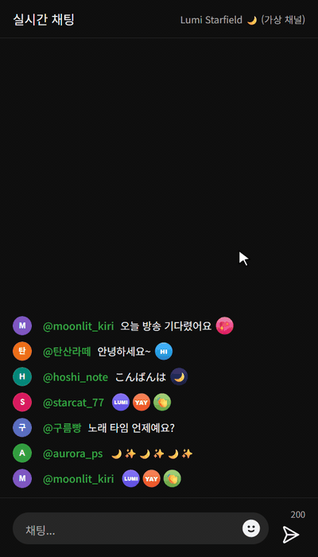

# yt-subs-ux

[](README.md)
[](README.ja.md)
[](README.en.md)

유튜브 채널 구독자·멤버를 위해 이모티콘 선택창을 개선하는 Chrome 확장 프로그램입니다. 이모티콘 순서를 원하는 대로 바꾸고, 자주 쓰는 이모티콘 조합이나 채팅 **탄막**을 저장해 두었다가 클릭 한 번으로 입력할 수 있습니다.

비공식 프로젝트이며 Google LLC와 관련이 없고 Google LLC의 보증을 받지 않았습니다. "YouTube"는 Google LLC의 상표입니다.

<p align="center">
  
  
  
</p>
<p align="center"><sub>채널 이모티콘 순서 바꾸기 · 채팅의 탄막을 저장해서 보내기 · 이모티콘 팔레트로 관용구 만들기<br>데모의 채널·시청자·이모티콘은 모두 가상입니다.</sub></p>

## 기능

### 이모티콘 순서

이모티콘 선택창의 카테고리 제목 오른쪽 **`⇅ 순서`** 버튼으로 순서를 바꿉니다.

- 드래그로 순서 변경 · 더블클릭: 맨 앞으로 · Alt+클릭: 맨 뒤로
- 채널 멤버십 이모티콘은 **채널별로** 따로 저장됩니다.
- 일반 유니코드 카테고리(인물, 자연 …)도 바꿀 수 있습니다.
- 나중에 채널에 새 이모티콘이 추가되면 기본 순서대로 맨 뒤에 붙습니다.

### 이모티콘 관용구(탄막) — 라이브 채팅

자주 함께 쓰는 이모티콘 조합이나 채널 시청자들이 공유하는 탄막(예: `🥀🎶🥀🎶🥀🎶`)을 저장해 두고 클릭 한 번으로 입력합니다.

- 이모티콘 선택창의 두 번째 카테고리로 **관용구**(말풍선 탭)가 추가됩니다.
  - 클릭: 채팅 입력창에 입력
  - 우클릭: 편집 / 텍스트로 복사 / 삭제
  - 드래그: 순서 변경
- **등록 방법**
  - 채팅 메시지에 마우스를 올리면 나오는 **☆** 버튼 → 그 메시지를 그대로 관용구로 저장
  - 관용구 카테고리의 **`+ 추가`** → 팝업에서 이모티콘 팔레트(카테고리 탭·검색)와 텍스트 입력으로 작성. 팔레트에서 기존 관용구를 눌러 이어 붙일 수도 있습니다.
- **범위**: `이 채널 전용`(기본) 또는 `모든 채널 공용`. 채널 멤버십 이모티콘이 들어간 관용구는 그 채널 전용으로만 저장됩니다.
- 이모티콘은 유튜브 이모티콘 선택창을 통해 입력되므로, 직접 고른 것과 똑같이 전송됩니다.

## 설치

1. [Releases](https://github.com/crazylulu9999/yt-subs-ux/releases)에서 zip을 내려받아 압축을 풀거나, 이 저장소를 clone합니다.
2. `chrome://extensions`를 열고 **개발자 모드**를 켭니다.
3. **압축해제된 확장 프로그램을 로드합니다**를 눌러 `manifest.json`이 있는 폴더를 선택합니다.
4. 이미 열려 있는 유튜브 탭을 새로고침합니다.

업데이트할 때는 파일을 교체한 뒤 `chrome://extensions`에서 이 확장 프로그램의 새로고침(↻) 버튼을 누르고, 유튜브를 새로고침하세요.

## 데이터 저장 · 개인정보

- 이모티콘 순서와 관용구는 **이 브라우저에만**(`chrome.storage.local`) 저장됩니다. 다른 PC·브라우저와 동기화되지 않으며, 확장 프로그램을 삭제하면 함께 지워집니다.
- 외부 서버로 어떤 데이터도 보내지 않습니다. 요청하는 권한은 `storage` 하나뿐입니다.
- `https://www.youtube.com/*` 페이지에서만 동작합니다.

## 제한 사항

- 관용구는 **라이브 채팅**에서만 동작합니다. (다시보기 채팅·댓글 제외)
- 채널은 이모티콘 선택창이나 채팅에 있는 채널 멤버십 이모티콘, 또는 영상 페이지에 함께 열린 채팅이라면 그 영상의 채널 정보로 판별합니다. 이모티콘 선택창을 한 번 열면 대개 인식됩니다. 판별되지 않으면(예: 채널 이모티콘이 보이지 않는 팝아웃 채팅) `모든 채널 공용`으로만 저장할 수 있습니다.
- 유튜브 화면 구조가 바뀌면 버튼이나 이모티콘 입력이 동작하지 않을 수 있습니다.

## 프로젝트 구조

```
manifest.json            확장 프로그램 설정 (Manifest V3)
content/
  theme.js               다크 모드 감지 (<html class="ytx-dark">)
  emoji-order.js / .css  이모티콘 순서
  phrases.js / .css      이모티콘 관용구(탄막)
```

빌드 과정이 없는 순수 JavaScript/CSS입니다. 파일을 수정하고 확장 프로그램을 새로고침하면 바로 반영됩니다.

## 동작하지 않을 때

유튜브 화면이 바뀌었을 수 있습니다. 스크린샷과, 가능하면 이모티콘 선택창이나 채팅 입력창의 HTML(개발자 도구 → 요소 우클릭 → Copy → Copy outerHTML)을 첨부해 [이슈](https://github.com/crazylulu9999/yt-subs-ux/issues)를 남겨 주세요. 올리기 전에 다른 시청자의 닉네임과 채팅은 지워 주세요.

## 라이선스

[MIT License](LICENSE)
